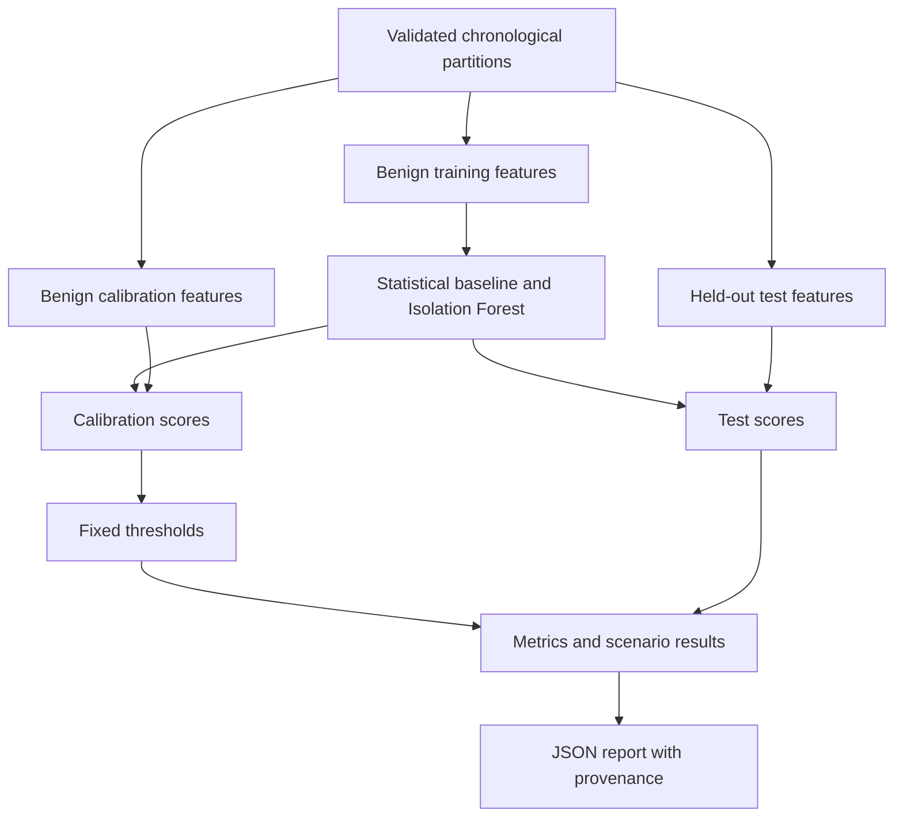

# Network Flow Anomaly Lab

Reproducible network-flow anomaly detection with Isolation Forest,
a robust statistical baseline, chronological evaluation and auditable reports.

An educational defensive machine-learning project. An anomaly score is
not an attack probability or proof of malicious activity.

## Features

- Validate structured JSONL flow records and UTC timestamps.
- Keep labels, scenario names and session identifiers outside model features.
- Enforce chronological train, calibration and test partitions.
- Reject shared session groups and repeated sample identifiers.
- Train detectors exclusively on designated benign training records.
- Calibrate thresholds using benign calibration scores.
- Evaluate both detectors on the same held-out test records.
- Report confusion matrices, precision, recall, F1 and false-positive rates.
- Report Average Precision and trapezoidal PR-AUC separately.
- Include per-scenario results, input fingerprints and dependency versions.
- Export complete JSON reports without overwriting existing files.

## Installation

Use Python 3.12 or newer. These commands target Linux and must be run
from the repository root.

```bash
python3 -m venv .venv
source .venv/bin/activate
python -m pip install --only-binary=:all: -r requirements-dev.lock
python -m pip install --no-build-isolation --no-deps .
python -m pip check
```

The dependency snapshot pins exact versions without artifact hashes.
A clean Python 3.14 installation was verified locally.
Other supported Python versions require independent verification.

## Usage

Run the bundled experiment:

```bash
network-flow-anomaly --data-directory data/synthetic/v1
```

Export a report to a new file:

```bash
mkdir -p reports
network-flow-anomaly \
  --data-directory data/synthetic/v1 \
  --output reports/assessment.json
```

Existing output files are refused. Choose a new name for another export.

Inspect configuration options:

```bash
network-flow-anomaly --help
```

Exit code `0` means the experiment completed, including when anomalies
were flagged. Exit code `2` indicates a usage, analysis or export error.

The default seed is 42 and the calibration false-positive target is 0.05.
Do not select new settings by repeatedly inspecting final test results.

## Architecture



See [Architecture](docs/architecture.md) for feature definitions and
evaluation boundaries.

## Observed Synthetic Results

Seed 42, 600 training records, 300 calibration records and 400 test records.
The test contains 103 designated suspicious records and 297 benign records.

| Metric | Robust deviation | Isolation Forest |
| --- | ---: | ---: |
| True positives | 14 | 47 |
| False positives | 11 | 8 |
| False negatives | 89 | 56 |
| True negatives | 286 | 289 |
| Precision | 0.5600 | 0.8545 |
| Recall | 0.1359 | 0.4563 |
| F1 | 0.2188 | 0.5949 |
| False-positive rate | 0.0370 | 0.0269 |
| Average Precision | 0.5519 | 0.7642 |
| Trapezoidal PR-AUC | 0.5478 | 0.7600 |

These are observed results on the bundled synthetic dataset.
They do not establish real-world attack detection performance.

Isolation Forest missed 56 of the 103 designated suspicious examples.
The statistical baseline missed 89. Both generated false positives.

See [Evaluation](docs/evaluation.md) for the protocol and limitations.

## Quality Checks

```bash
python -m ruff check .
python -m ruff format --check .
python -m pytest -q
```

The latest observed local suite passed 98 tests.
A fresh Git clone, Python 3.14 environment, non-editable installation and
exported experiment were independently verified with matching results.

GitHub Actions passed on Python 3.12 and 3.14 for commit `822398d`.

Verified run: [CI results](https://github.com/yahyarabass06-cell/network-flow-anomaly-lab/actions/runs/38172145616).

## Security Considerations

Use synthetic data or records you are authorized to analyze.
Real flow metadata and reports may contain sensitive information.
Keep private data and generated reports outside public repositories.

No active scanning, packet interception or automatic blocking is performed.
Models are trained in memory; no pickle or joblib artifact is loaded.

See [Security Considerations](SECURITY.md).

## Limitations

- Synthetic labels describe constructed scenarios, not verified attacks.
- Only one seed and one final test experiment have been evaluated.
- Shared generator assumptions can make synthetic evaluation optimistic.
- Session separation does not establish independence of real traffic.
- Individual flow features cannot establish scanning or lateral movement.
- Input files must remain stable while being read.
- Datasets, features and predictions are held in memory.
- Timings are single-run measurements, not production benchmarks.
- Export requires local filesystem support for hard links.
- No model persistence, live collection or drift monitoring is implemented.

## Future Work

- Evaluate independently labeled, licensed real datasets.
- Define new validation periods before changing model settings.
- Measure performance across independently generated datasets.
- Add resource limits and broader input-boundary tests.
- Evaluate drift and monitoring requirements.
- Design trusted model persistence with compatibility checks.

## License

Distributed under the [MIT License](LICENSE).
